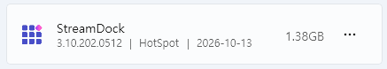
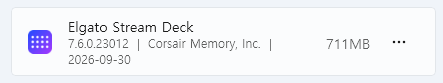

  

<h1 align="center">Hellgato</h1>

  <strong>Unofficial hardware. Official software.</strong>

  <a href="https://github.com/restarea92/hellgato/releases/download/v0.0.7-beta/Hellgato-0.0.7-beta-Setup.exe"><strong>Download for Windows (.exe)</strong></a> ·
  <a href="docs/guide.md">Guide &amp; development</a> ·
  <a href="https://github.com/restarea92/hellgato/issues">Report an issue</a>

Hellgato is an open-source Windows bridge that brings third-party hardware into the official Elgato Stream Deck app. Configure your actions, profiles and plugins in Stream Deck; Hellgato connects them to your hardware.

  
   Example setup captured with an earlier beta.

## Why Hellgato?

Use the official Stream Deck app with your Mirabox hardware without keeping StreamDock installed. In the Windows setup shown below, StreamDock's reported installation size was 1.38 GB, compared with 711 MB for Stream Deck.

| Application | Version | Windows-reported installed size |
| --- | --- | --- |
| StreamDock | 3.10.202.0512 | 1.38 GB |
| Elgato Stream Deck | 7.6.0.23012 | 711 MB |

  
  

These are installation estimates for the shown versions. Hellgato and additional plugins require extra disk space; runtime CPU and RAM usage have not been benchmarked.

## Stream Deck compatibility

Targets **Stream Deck 7.5.1 and later** on Windows x64, tested through **7.6.0.23012**. Compatibility is checked before connecting.

| Stream Deck version | Release date | Test status |
| --- | --- | --- |
| 7.5.1 | [2026-07-28](https://help.elgato.com/hc/en-us/articles/49238316077713-Elgato-Stream-Deck-7-5-1-Release-Notes) | Tested |
| 7.6.0.23012 | [2026-09-22](https://help.elgato.com/hc/en-us/articles/51156609278737-Elgato-Stream-Deck-7-6-Release-Notes) | Tested (latest) |

## Supported devices

Supports one connected N4 Pro at a time. The tested device and stock firmware are listed below.

| Device | Tested firmware | Controls | Platform | Status |
| --- | --- | --- | --- | --- |
| Mirabox N4 Pro E | `V4.N4 Pro E.02.010` | 10 LCD keys, 4 dials, touch strip | Windows x64 | Supported beta device |

**Version:** `0.0.7-beta`. Other devices and firmware versions have not been validated.

## Get started

1. Install the official [Stream Deck app](https://www.elgato.com/downloads).
2. Download and run the [Hellgato Windows installer](https://github.com/restarea92/hellgato/releases/download/v0.0.7-beta/Hellgato-0.0.7-beta-Setup.exe).
3. Connect your N4 Pro over USB and open Hellgato.
4. In Stream Deck, open **Network** and connect to `127.0.0.1:5343` on first use.

The installer bundles the runtimes and USB SDK; no source code, build tools or StreamDock app are required. Install any extra Stream Deck plugins separately.

## Features

- Configure actions, profiles, brightness and sleep timing in Stream Deck.
- Set screensavers in Stream Deck; Hellgato plays the saved originals through the N4 SDK. Sleep turns the screen off when no screensaver is set, or dims the screensaver and turns off knob lighting. Wake restores the display and brightness.
- Export profiles as a `.hellgatoProfiles` bundle (`Ctrl+E`); import bundles or `.streamDeckProfile` files (`Ctrl+I`). Replaced profiles are backed up.
- Tray operation, optional Windows sign-in startup and eleven interface languages.

### Planned N4 Pro controls

- Knob RGB colors: all four together or individually, independent brightness and default-effect reset.
- Vibration on/off.
- Existing boot video on/off.
- Upload and reset the device-stored boot/standby logo.

## Beta notes

The installer is unsigned.

Ten-key and touch-strip support temporarily adjust the running Stream Deck process's memory; the executable on disk stays unchanged. Simultaneous use with a genuine Stream Deck + is outside this beta's scope.

N4 Pro does not report dial release events. Dial holds, actions triggered on release, press-duration detection, momentary actions, hold-to-repeat, press-and-turn, and overlapping held dial presses cannot be reproduced accurately with stock firmware.

N4 Pro stores a single static boot/standby logo on the device, separate from PC-stored screensavers. It appears after the boot video and when no app is connected. Hellgato does not yet support uploading or resetting it through Stream Deck's **Advanced → Standby image** setting; using that setting may disconnect the virtual device.

Touch alignment across plugins, extended use and reboot recovery need broader hardware testing. [Report issues](https://github.com/restarea92/hellgato/issues) with your device, Stream Deck version and reproduction steps. Review logs and exported profiles for personal information before sharing.

## Documentation and contributing

See the [guide](docs/guide.md) for everyday use, local data, builds and contributing, or the [Node bridge API](packages/core) for device integrations. Bug fixes, hardware reports and [translation feedback](https://github.com/restarea92/hellgato/issues/new?template=translation.yml) are welcome.

## License

[MIT](LICENSE). Bundled dependencies keep their own licenses; see [third-party notices](installer/THIRD-PARTY-NOTICES.txt).

Hellgato is an independent project, not affiliated with or endorsed by Elgato or Mirabox.
