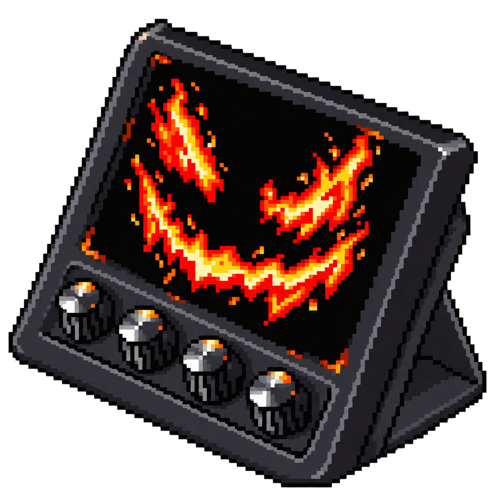
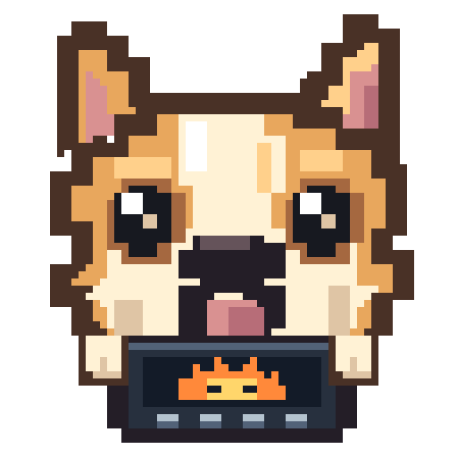
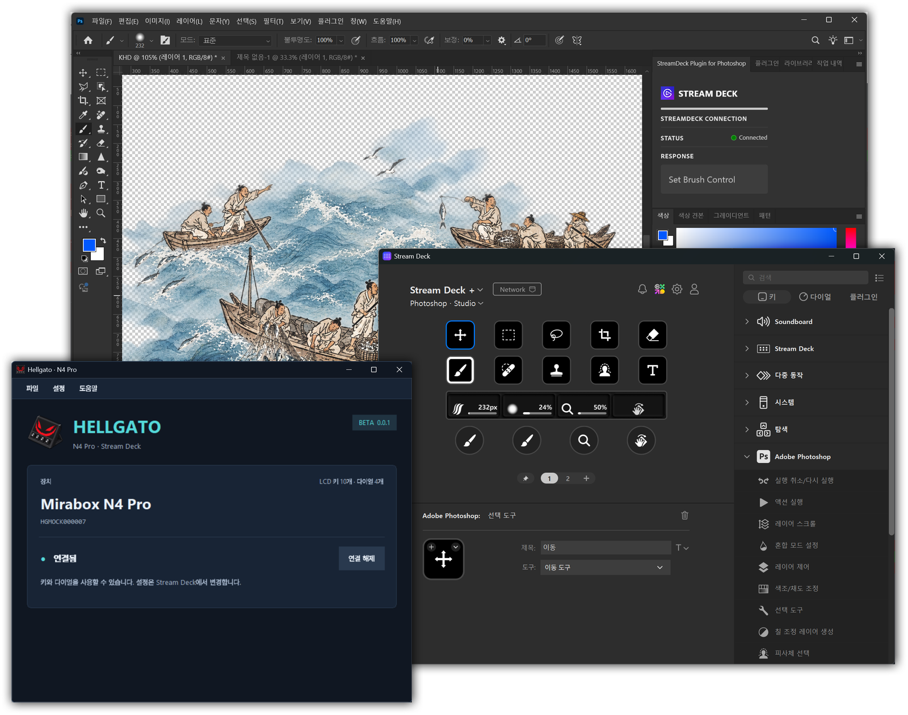

  

<h1 align="center">Hellgato</h1>

<strong>Unofficial hardware. Official software.</strong>

  <a href="https://github.com/restarea92/hellgato/releases/download/v0.1.8/Hellgato-0.1.8-Setup.exe"><strong>Download for Windows (.exe)</strong></a> ·
  <a href="https://github.com/restarea92/hellgato/releases/tag/v0.1.8">Release notes &amp; SHA-256</a> ·
  <a href="docs/guide.md">Guide</a> ·
  <a href="https://github.com/restarea92/hellgato/issues">Report an issue</a>

Use your **Mirabox N4 Pro with the official Elgato Stream Deck app**. Hellgato Stream Dog connects the hardware; Stream Deck runs your actions, profiles and plugins. No StreamDock app is required.

  

  
   Example setup captured with an earlier beta.

## Get started

1. Install the official [Stream Deck app](https://www.elgato.com/downloads), then run the **Windows installer** above as administrator. Setup closes both apps and retains existing settings and profiles.
2. Choose Hellgato's launch options, open Stream Deck yourself and connect one N4 Pro over USB. Open Hellgato if needed.
3. In Stream Deck, open **Network**, connect to `127.0.0.1:5343` and confirm pairing.

Runtimes and the USB SDK are bundled. See the [guide](docs/guide.md#installation-and-updates) for updates, extra plugins and **Prepare Stream Deck**.

## Before you install

- Windows x64; tested with N4 Pro E firmware `V4.N4 Pro E.02.010` and Stream Deck `7.6.0.23012`. Other combinations are unverified.
- The installer is unsigned. Startup support adjusts Stream Deck's process memory on every launch, even with N4 Pro unplugged; `StreamDeck.exe` stays unchanged on disk.
- Simultaneous use with a genuine **Stream Deck + is unsupported** while startup support is installed.
- Dial holds/release actions and **Advanced → Standby image** are unsupported. Read the [full limitations](docs/guide.md#compatibility-and-limitations).

## How it works

  
   Conceptual overview: input goes to Stream Deck; display updates return to N4 Pro. The virtual device is a logical identity.

Normal images pass through the Node SDK session and USB worker; saved screensavers play from the worker's local cache. [Architecture details](docs/guide.md#how-it-works).

## Develop and contribute

The reusable TypeScript SDK (`hellgato` and `@hellgato/core`) is separate from the Windows client.

- [Build, test and contribute](docs/guide.md#build-and-test) · [Core API](packages/core) · [Adapter guide](docs/adapters/contributing.md)
- [Features and compatibility](docs/guide.md) · [Translation feedback](https://github.com/restarea92/hellgato/issues/new?template=translation.yml)
- [Version management](.changeset/README.md) · [Windows release operations](docs/windows-releases.md)

## License

[MIT](LICENSE). Bundled dependencies retain their own licenses; see [third-party notices](installer/THIRD-PARTY-NOTICES.txt).

Hellgato is an independent project, not affiliated with or endorsed by Elgato or Mirabox.
