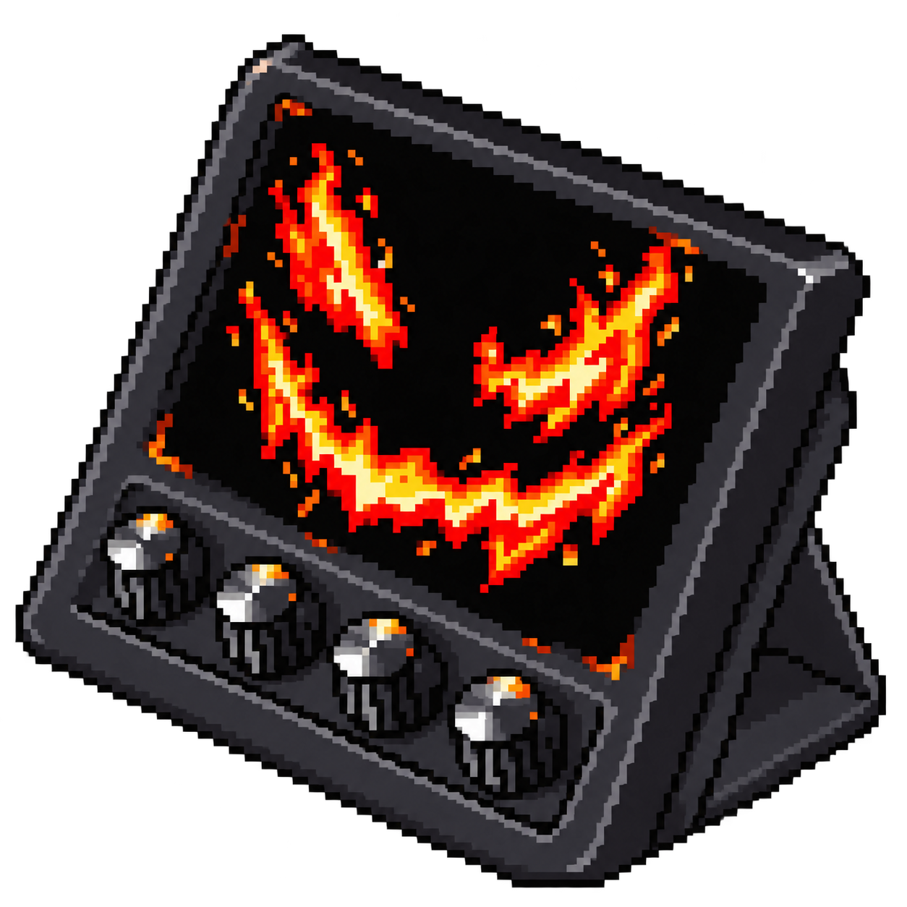
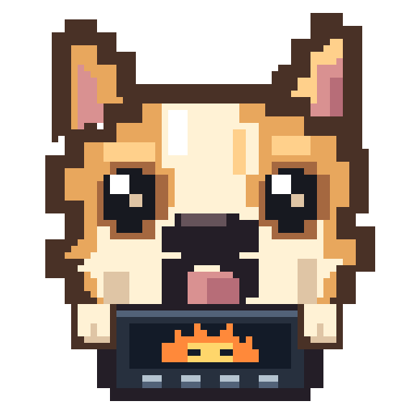
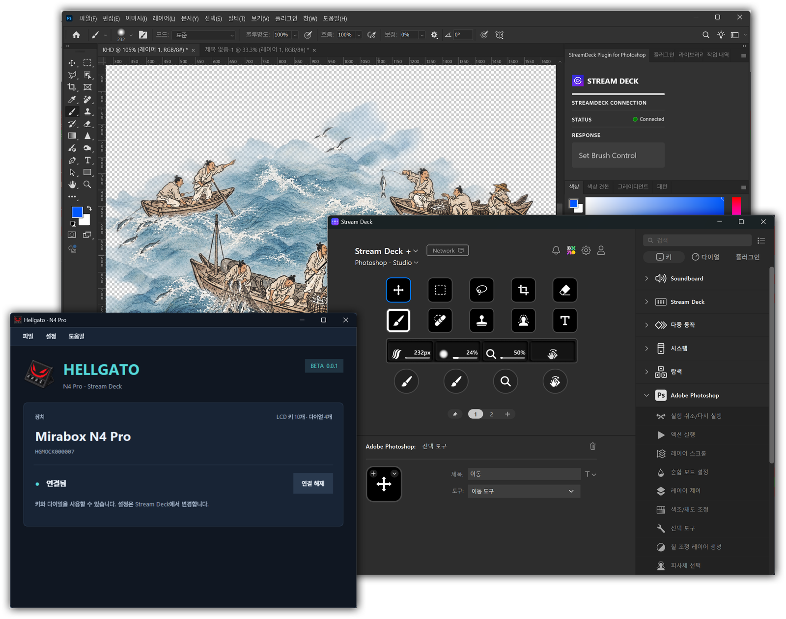

  

<h1 align="center">Hellgato</h1>

<strong>Unofficial hardware. Official software.</strong>

  <a href="https://github.com/restarea92/hellgato/releases/download/v0.2.0/Hellgato-0.2.0-Setup.exe"><strong>Download 0.2.0 Beta for Windows (.exe)</strong></a> ·
  <a href="https://github.com/restarea92/hellgato/releases/tag/v0.2.0">Release notes &amp; SHA-256</a> ·
  <a href="docs/compatibility/stream-dog-rust-beta.md">Guide</a> ·
  <a href="https://github.com/restarea92/hellgato/issues">Report an issue</a>

Use your **Mirabox N4 Pro with the official Elgato Stream Deck app**. Hellgato Stream Dog connects the hardware; Stream Deck runs your actions, profiles and plugins. No StreamDock app is required.

  

  
   Example setup captured with an earlier beta.

## Get started

1. Install the official [Stream Deck app](https://www.elgato.com/downloads). Close Stream Deck, then run the **Windows installer** above as administrator. Setup stops Hellgato, removes its legacy Python runtime, and retains settings and profiles.
2. Choose Hellgato's launch options, open Stream Deck yourself and connect one N4 Pro over USB. Open Hellgato if needed.
3. In Stream Deck, open **Network**, connect to `127.0.0.1:5343` and confirm pairing.

Node and Rust workers are bundled; Python is not required. See the [beta guide](docs/compatibility/stream-dog-rust-beta.md) for adapters, backups and **Prepare Stream Deck**. The previous [0.1.8 release](https://github.com/restarea92/hellgato/releases/tag/v0.1.8) remains available.

## Before you install

- Windows x64; tested with N4 Pro E firmware `V4.N4 Pro E.02.010` and Stream Deck `7.6.0.23012`. Untested host builds and firmware show warnings without blocking core connection. Native layout extensions still require compatible structures.
- N4 / TS10N4 and 293S / TS115 compatibility adapters are included as hardware-unverified betas. Multiple physical devices are also unverified.
- The installer is unsigned. Startup support adjusts Stream Deck's process memory on every launch, even with N4 Pro unplugged; `StreamDeck.exe` stays unchanged on disk.
- Simultaneous use with a genuine **Stream Deck + is unsupported** while startup support is installed.
- Dial holds/release actions and **Advanced → Standby image** are unsupported. Read the [full limitations](docs/guide.md#compatibility-and-limitations).

## How it works

Device input goes through an independent Rust adapter to the Node core and Stream Deck. Key images, the touch strip and screensavers compose into one device canvas. N4 Pro receives complete frames; compatibility adapters serialize model-specific regions internally. The Rust GUI manages devices, adapters, backups and the tray. [Architecture details](docs/architecture/0002-full-frame-runtime.md).

## Develop and contribute

The reusable TypeScript SDK (`hellgato` and `@hellgato/core`) is separate from the Windows client.

- Node/Rust beta: [Architecture](docs/architecture/0002-full-frame-runtime.md) · [Build and QA](apps/stream-dog/rust/README.md) · [Adapter development](docs/adapters/frame-adapter-guide.md)

- [Build, test and contribute](docs/guide.md#build-and-test) · [Core API](packages/core) · [Adapter guide](docs/adapters/contributing.md)
- [Features and compatibility](docs/guide.md) · [Translation feedback](https://github.com/restarea92/hellgato/issues/new?template=translation.yml)
- [Version management](.changeset/README.md) · [Windows release operations](docs/windows-releases.md)

## License

[MIT](LICENSE). Bundled dependencies retain their own licenses; see [third-party notices](installer/THIRD-PARTY-NOTICES.txt).

Hellgato is an independent project, not affiliated with or endorsed by Elgato or Mirabox.
