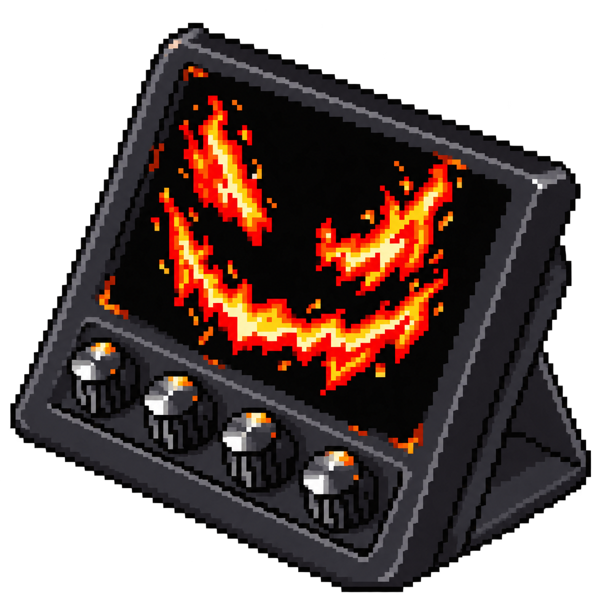

# Hellgato

**Unofficial hardware. Official software.** Use compatible controllers with the official Elgato Stream Deck app. Stream Dog manages the connection; Stream Deck runs your profiles, actions and plugins. No StreamDock app is required.

[Download 0.3.1 for Windows x64](https://github.com/restarea92/hellgato/releases/download/v0.3.1/Hellgato-0.3.1-Setup.exe) · [Release notes and SHA-256](https://github.com/restarea92/hellgato/releases/tag/v0.3.1) · [Website](https://hellgato-streamdog.vercel.app)

## Get started

1. Install the official [Stream Deck app](https://www.elgato.com/downloads), then run Hellgato setup. Setup closes both apps automatically, removes the owned legacy Python runtime, and retains settings, profiles and plugins. Stream Deck reopens if it was running.
2. Open Stream Dog and choose the matching adapter. Discover and connect a USB controller, or open its virtual device to use it without hardware.
3. In Stream Deck, add the Network Device at `127.0.0.1:5343` and confirm pairing if it does not appear automatically.

Node and Rust workers are bundled. Python is not required. Closing the window keeps the core running in the tray; use Quit to disconnect.

Connection retention is on by default. The optional native virtual controller shows the same composed screen and accepts mouse input. Drag its body to move it, use the dial controls in 45-degree steps, and change its default 50% size in Settings. Showing or hiding it is independent of the connection setting.

## Compatibility

| Device | Status |
| --- | --- |
| Mirabox N4 Pro E | Display, controls, screensaver and knob brightness verified on hardware |
| N4 / TS10N4 | Included beta adapter; simulation only |
| 293S / TS115 | Included beta adapter; simulation only |

Tested with Stream Deck **7.6.0.23012** and N4 Pro E firmware **V4.N4 Pro E.02.010**. Untested versions show compatibility warnings. Multiple physical devices remain unverified. Simultaneous use with a genuine Stream Deck +, physical dial holds and standby-image upload are unsupported.

The unsigned installer adds owned startup support that adjusts Stream Deck process memory on launch; it does not rewrite `StreamDeck.exe`. Automatic updates are not enabled. Read the [user guide](docs/guide.md) before installation.

## How it works

An independent Rust adapter translates device input for the Node core and Stream Deck. The core composes key images, one continuous touch strip and screensavers into a retained device canvas. N4 Pro receives complete USB frames; compatibility adapters split that canvas internally. The Rust GUI manages devices, adapters, backups and the tray, and generates its floating virtual controllers from adapter coordinates and capabilities.

- [Runtime boundaries](docs/architecture/0002-full-frame-runtime.md)
- [Build and QA](apps/stream-dog/rust/README.md) · [Create an .hga adapter](docs/adapters/frame-adapter-guide.md)
- [Public SDK](packages/hellgato/README.md) · [Versioning](.changeset/README.md) · [Windows releases](docs/windows-releases.md)
- [Report an issue](https://github.com/restarea92/hellgato/issues)

## License

[MIT](LICENSE), with [third-party notices](installer/THIRD-PARTY-NOTICES.txt). Independent project; not affiliated with or endorsed by Elgato or Mirabox.
