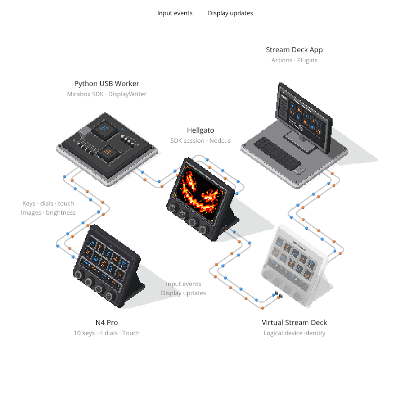

# Hellgato guide

[Back to the README](../README.md)

## Everyday use

- **Connection:** the control changes between Connect, Cancel and Disconnect to match the current state. USB reconnects are handled automatically.
- **File menu:** export this device's profiles into one `.hellgatoProfiles` bundle (`Ctrl+E`), or import a bundle or several `.streamDeckProfile` files (`Ctrl+I`). Imports back up replaced profiles and stop Stream Deck while applying them. An active Hellgato session resumes afterward.
- **Tray:** closing the window keeps Hellgato running. Choose Open or Exit from its tray menu.
- **Startup:** the installer offers Windows sign-in startup, enabled by default.
- **Settings → Preferences:** choose the interface language. Changes apply immediately and persist across restarts. First launch uses the Windows display language, with English as fallback.

The main window shows the device and connection status. Profile tasks display a separate progress or result notification that can be dismissed when complete. Menus support keyboard navigation with `Alt+F`, `Alt+S` and `Alt+H`, arrow keys, Enter and Escape. The title bar uses dark Windows styling where supported.

Stream Deck account files are not included, and the automatic app-switching field is reset. Action settings are retained and may contain personal paths or credentials; review a profile bundle before sharing it. Export asks for confirmation after you choose a save location; Cancel leaves the destination unchanged and creates no bundle. After transferring profiles, configure app switching and check action paths on the destination PC.

## Compatibility and beta limits

Hellgato targets **Stream Deck 7.5.1 and later** on Windows x64, tested through **7.6.0.23012**. See the [Stream Deck version table](../README.md#stream-deck-compatibility) for tested releases and their release dates. Compatibility checks inspect Stream Deck's internal structure and live device geometry before connecting.

The tested device is a **Mirabox N4 Pro E** running stock firmware **`V4.N4 Pro E.02.010`**. One connected N4 Pro is supported at a time; see the [device and firmware table](../README.md#supported-devices) for the tested hardware scope.

Ten-key support and touch strip feedback scheduling require temporary changes to the running Stream Deck process's memory. Screen update requests enable 16 ms feedback checks for that composer; after two seconds without requests, it returns to Stream Deck's original idle wait. This improves animation delivery without polling continuously while idle. Internal code signatures and loaded bytes are checked before patching; unsupported layouts are rejected. Its executable on disk is unchanged. Simultaneous use with a genuine Stream Deck + is outside this beta's scope.

N4 Pro does not report dial release events, so holds, release-triggered actions, press-duration detection, momentary actions, hold-to-repeat, press-and-turn and overlapping held dial presses cannot be reproduced accurately. This limit concerns dial buttons, not LCD keys or touch-strip holds.

Brightness, idle timeout, full LCD images, full-screen and individual-key color fills are forwarded to hardware. Configure screensavers in Stream Deck as usual: Hellgato reads the selected original from Stream Deck's settings and plays cached full-screen frames through the N4 SDK. Animated WebP/GIF frame timing is preserved without sending separate images for every key. The SDK streams from the PC; this does not store the animation in device firmware.

Sleep without a screensaver uses N4 Pro's native screen-off command. With a screensaver, the image appears first and dims over 0.3 seconds to the LCD's minimum brightness, while knob lighting turns off immediately. Wake restores action images while dim/off, then fades back to the Stream Deck brightness; knob brightness follows it. Display animations do not reset the idle timer. Sleep timing is stored per virtual device and returned to Stream Deck after reconnection. Manual Sleep is recognized early when a recent key release is followed by timeout-disable and brightness-fade commands; when Stream Deck sends only brightness changes, screen-off waits for its zero-brightness command.

Five-minute idle activation, screensaver dimming and wake behavior have been confirmed on the test device. Touch alignment across profiles and plugins, extended animation playback and Windows reboot recovery need broader hardware testing. Report issues with the device, Stream Deck version, reproduction steps and relevant logs. Check logs for personal paths or profile information before sharing them.

Advanced standby-image set/reset is not supported: its unhandled image-upload command can disconnect the virtual device. An equivalent N4 Pro API for persistent standby-image storage has not been confirmed.

## How it works

The design goal is Stream Deck's native user experience with the hardware's native performance. Keep configuration, actions and profiles in the official app, and use the device SDK for execution wherever it avoids unnecessary conversion or transport. Input and output may take different paths: forward input to Stream Deck, while displays can use its saved assets directly. Preserve the user's selected content, timing and behavior when choosing an output path.

Hellgato presents N4 Pro as a network-connected Stream Deck. The official app runs actions and plugins; the Mirabox SDK handles USB input and display output.

<p align="center">
  
</p>

Blue carries input toward Stream Deck; orange carries display updates toward N4 Pro. The virtual device is the identity exposed by CORA. The Python worker sends input over `stdin` and reads display events and images from local files. CORA uses `127.0.0.1:5343` for pairing and `127.0.0.1:5344` for device traffic. Screensavers use the original asset saved by Stream Deck, bypassing its per-frame display transport.

DisplayMirror combines repeated updates to each key or touch region within a batch. The default frame mode sends only the changed touch-strip region after its initial frame.

## Local data

| Location | Contents |
| --- | --- |
| `%LOCALAPPDATA%\Programs\Hellgato` | Installed application |
| `%LOCALAPPDATA%\Hellgato\settings.json` | Persistent device identity |
| `%LOCALAPPDATA%\Hellgato\preferences.json` | Interface language |
| `%LOCALAPPDATA%\Hellgato\display-HGMOCK*.json` | Per-device idle timeout |
| `%APPDATA%\Elgato\StreamDeck\Assets` | Screen saver originals saved by Stream Deck; the selection is in its per-device Windows registry settings |
| `%LOCALAPPDATA%\Hellgato\bridge.log` | Connection and error logs |
| `%LOCALAPPDATA%\Hellgato\traces` and `images` | Local device events and received display images |
| `%LOCALAPPDATA%\Hellgato\profile-backups` | Profiles saved before Stream Deck restarts |
| `%LOCALAPPDATA%\Hellgato\profile-import-backups` | Profiles replaced during import |

Use **Help → Open logs** to access the data folder, or **Help → About Hellgato** for version and license information. Uninstalling keeps settings and backups. Existing device identities and profile formats remain compatible.

## Build and test

Use Python 3.13 x64, Git and Inno Setup 6.7.3. In PowerShell, from the repository root:

```powershell
python -m venv work/build-venv
./work/build-venv/Scripts/python.exe -m pip install -r installer/requirements-build.txt
./work/build-venv/Scripts/python.exe scripts/prepare-windows.py
./work/build-runtime/node.exe scripts/prepare-cora.mjs

./work/build-venv/Scripts/python.exe -m unittest discover -s test -p 'test_*.py'
./work/build-runtime/node.exe --test test/*.test.mjs

$env:HELLGATO_NODE = (Resolve-Path ./work/build-runtime/node.exe).Path
./work/build-venv/Scripts/python.exe app/hellgato.py
```

Build the installer:

```powershell
./scripts/build-windows.ps1 -Python ./work/build-venv/Scripts/python.exe -Iscc 'C:\Path\To\Inno Setup 6\ISCC.exe'
```

Build inputs are pinned and verified against upstream source metadata and checksums. Outputs are `dist/Hellgato-0.0.7-beta-Setup.exe` and its SHA-256 sidecar. Personal profiles and logs are excluded. The Windows beta release workflow runs manually or when release notes under `docs/releases/` are added or changed on `main`. Update the version, installer filenames and workflow release command together before publishing release notes. Other pushes run checks without publishing.

| Directory | Purpose |
| --- | --- |
| `app/` | Windows launcher, interface and localization |
| `app/n4/` | Hardware input, display, profiles and compatibility |
| `app/cora/` | Stream Deck network transport |
| `app/locales/` | Interface translations |
| `scripts/` | Dependency preparation, geometry adjustment and builds |
| `installer/` | Packaging and third-party notices |
| `test/` | Compatibility, profiles, UI state and CORA checks |

## Contributing

Open an issue or submit a pull request with a focused change. Run both test suites and add tests for changed behavior. Include the hardware and Stream Deck version for physical tests. Do not commit personal profiles, logs or generated build output.

### npm bridge packages

`hellgato` re-exports `@hellgato/core`. Both are built from `app/cora/bridge.mjs`, which the Windows app also uses. See [the core API](../packages/core) for usage and supported scope.

With the pinned Node 24 runtime prepared, build and pack from the repository root:

```powershell
./work/build-runtime/node.exe scripts/build-npm.mjs
npm pack ./packages/core --pack-destination ./work
npm pack ./packages/hellgato --pack-destination ./work
```

Keep both package versions and the facade's exact core dependency in sync. The root package stays private. Packages include the prepared DeckBridge runtime and its license, so consumers need no Git checkout or build step. Publish the reviewed tarballs with the `beta` tag; npm publication is manual and is independent of the Windows installer release.

### Translations

The interface supports English, Korean, Spanish, Japanese, French, German, Russian, Italian, Brazilian Portuguese, Simplified Chinese and Traditional Chinese. Initial translations are open to native-speaker review.

1. Open the appropriate file in [`app/locales`](../app/locales). `en.json` is the source catalog.
2. Edit the text values, keeping message keys and placeholders such as `{count}` and `{filename}` unchanged. Use concise, neutral product language and consistent action names. Keep product names unchanged.
3. Preview the language in Hellgato and submit a pull request. You can use GitHub's file editor without setting up a local build.

Translation checks validate JSON, duplicate keys, missing/extra messages and placeholders. If you cannot submit a PR, use the [translation feedback form](https://github.com/restarea92/hellgato/issues/new?template=translation.yml).

The catalogs use standard flat JSON, compatible with translation platforms such as Weblate. No paid translation service or API key is required to run or build Hellgato.
